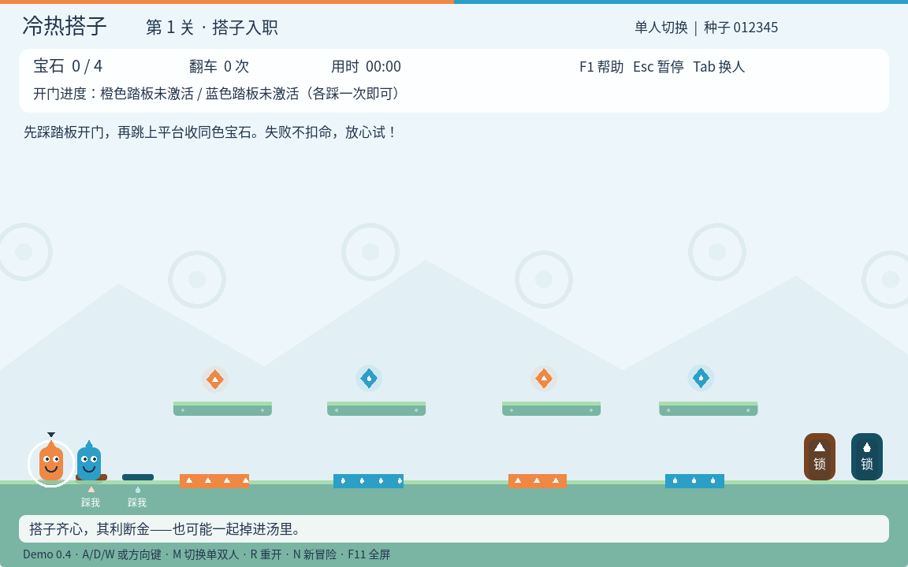

# 冷热搭子 · 摸鱼闯关队

Godot **4.6.3 标准版**制作的原创 2D 单人／本地双人合作闯关 Demo。橙蓝搭子踩机关、收宝石、跳过危险池，完成一张张离谱工单。

## 下载与运行

- [最新版 Godot 工程 ZIP](https://github.com/2584911836/LiGame/archive/refs/heads/main.zip)
- [v0.4.0 固定版本](https://github.com/2584911836/LiGame/archive/refs/tags/v0.4.0.zip)
- [v0.3.0](https://github.com/2584911836/LiGame/archive/refs/tags/v0.3.0.zip) · [v0.2.0](https://github.com/2584911836/LiGame/archive/refs/tags/v0.2.0.zip)

解压后，在 Godot 项目管理器导入 `project.godot`，等待首次字体导入完成，按 **F5**，选择“单人教学”或“双人教学”。无需 .NET、插件、导出模板、外部素材或联网服务。本仓库仅交付 Godot 工程。

## 当前内容

- 六关固定教学，逐步介绍合作开门、弹簧、同色开关桥梁和风场。
- 随机挑战与指定种子重玩，三套主题配色。
- 单人切换角色／双人同屏，两人可互相穿过避免堵路。
- 跳跃缓冲、离地宽容、松键短跳，键盘及双手柄输入映射。
- 标题、暂停、帮助、自动保存关数；音量、全屏、减少动态效果设置。
- 属性图案、基础合成音效、收集与过关粒子反馈。

## 怎么过关

1. 橙蓝角色各踩一次出生点右边的同色踏板，无需同时站住。两个踏板都“已踩”后，出口显示“开”。
2. 收齐四颗宝石，各角色只能收同色宝石。
3. 两人进入右侧各自的出口，约 1.8 秒后进入下一关；教学第六关结束后显示完成菜单。

顶部持续提示剩余条件。橙色免疫橙色池，蓝色免疫蓝色池，紫色池对双方危险。翻车时整队重生，本关宝石、踏板和桥梁保留；重开本关则清空。没有生命限制。

## 操作

| 操作 | 单人 | 本地双人 |
|---|---|---|
| 移动 | A/D 或 ←/→ | 橙 A/D；蓝 ←/→ |
| 跳跃 | W/↑/空格，短按短跳 | 橙 W；蓝 ↑ |
| 换人 | Tab | 分别操作 |
| 手柄 | 第一个手柄，左摇杆／方向键、A 跳、X 换人 | 两个手柄各控制一人 |

Esc／手柄 Start 暂停，F1 帮助，F11 全屏，M 切换单双人，R 重开，N 开始新的随机种子冒险。手柄映射已用模拟事件验证，尚需实机兼容性测试。

自动保存关数、种子和模式，继续游戏从本关起点开始；本关收集、开关进度不跨退出保存。设置保存在 Godot `user://settings.cfg`，进度为 `user://progress.cfg`。

## 开发与验证

- [开发文档](docs/DEVELOPMENT.md)：架构、规则、测试证据、已知限制和变更记录。
- [商用路线](docs/ROADMAP.md)：优先级、阶段验收和发布准备。
- 一键检查：`python3 tools/check.py`，需要 Godot 在 PATH 中。检查使用独立临时存档目录。
- 单项验证：`godot --headless --fixed-fps 60 --path . --script tests/traversal.gd`。

472 项规则／系统检查及 10 次完整路径通关通过。通关机器人使用真实按键、重力和碰撞，覆盖六关教学和四个指定种子；不能替代真人试玩。已在虚拟显示器检查实际渲染截图，尚未进行 Windows／macOS、真实音频设备和真实手柄验证。

这是持续迭代的玩法原型，尚未达到 Steam 商业发布标准。随机挑战采用固定区段中的受限组合，尚无敌人、联机、按键重映射、完整音乐或大量内容。名称、图形、地图和代码均不使用《森林冰火人》的资产。

## 许可

原创代码采用 [MIT](LICENSE)。子集化 Noto Sans CJK 字体采用 [SIL OFL](assets/FONT-LICENSE.txt)，字体应连同许可保留。新增中文文案后，可用 `tools/subset_font.py` 重建所需字形，详见开发文档。
